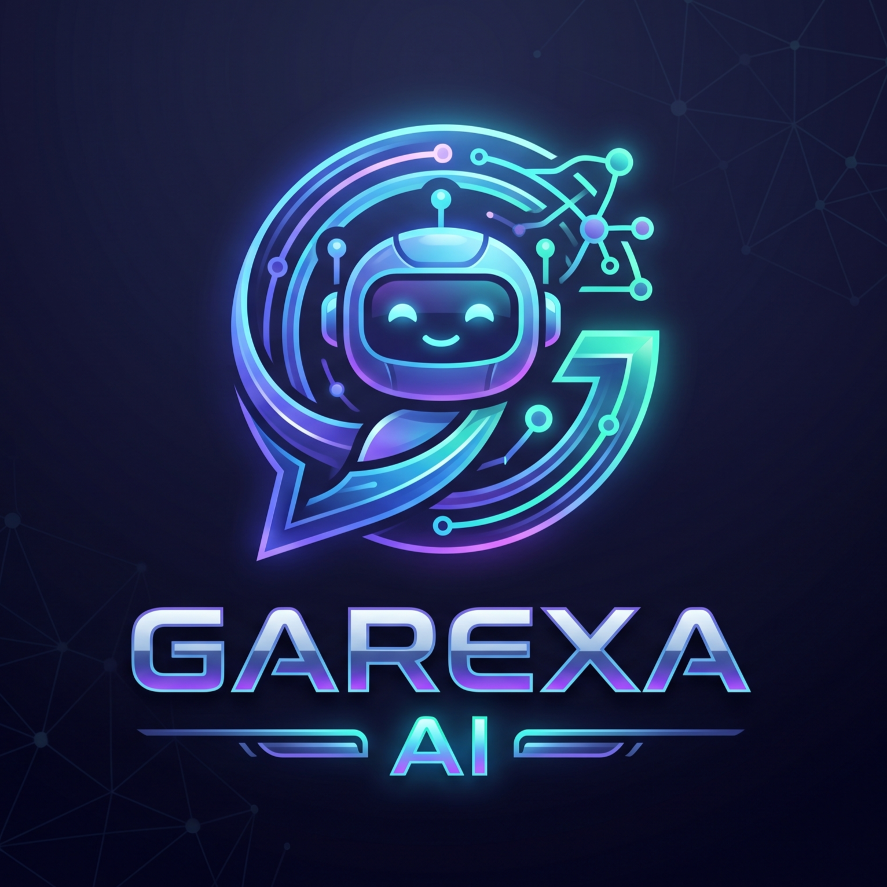

# Garexsa UI

<div align="center">



**Desktop AI Chat Application Powered by Gemma 4**

Privacy-focused • Offline-capable • Cross-platform

[Download](#-downloads) • [Features](#-features) • [Documentation](#-documentation) • [Building](#-building-from-source)

</div>

---

## 📖 About

Garexsa UI is a desktop application that lets you chat with Google's Gemma 4 AI model locally on your computer. All inference happens on your machine - no internet required after initial setup, ensuring complete privacy.

### Key Features

✅ **Privacy-First** - All data stays on your computer  
✅ **Offline-Capable** - Works without internet after setup  
✅ **Cross-Platform** - Windows & Linux support  
✅ **GPU Acceleration** - Automatic GPU detection and usage  
✅ **Multiple Models** - Support for multiple AI models  
✅ **Professional UI** - Clean, modern chat interface  

---

## 💾 Downloads

### Windows

| Version | Size | Model Included | Download |
|---------|------|----------------|----------|
| **Setup Installer** | 123.5 MB | ❌ No | [GarexsaUI-Setup-1.0.0.exe](../../releases) |

### Linux

| Version | Size | Model Included | Download |
|---------|------|----------------|----------|
| **.deb Package** | 137.5 MB | ❌ No | [garexsa-ui_1.0.0_amd64.deb](../../releases) |

**Note:** Non-portable versions require downloading the Gemma 4 model separately from [Kaggle](https://www.kaggle.com/models/google/gemma-4/tfLiteGemma4/gemma-4-e2b-it).

---

## 🚀 Quick Start

### Windows Installer
```
1. Download GarexsaUI-Setup-1.0.0.exe
2. Run the installer
3. Download Gemma 4 model from Kaggle
4. Place model in: C:\Program Files\garexsa-ui\resources\backend\models\
5. Launch "Garexsa UI" from Start Menu
```

### Linux .deb
```bash
# Install
sudo dpkg -i garexsa-ui_1.0.0_amd64.deb

# Download model and place in:
# /opt/garexsa-ui/resources/backend/models/

# Launch
garexsa-ui
```

### Portable Versions
Extract and run - model is pre-bundled and ready to use!

---

## ✨ Features

### Chat Interface
- 💬 Multiple chat sessions
- 📝 Markdown rendering
- 🎨 Syntax highlighting for code
- 🗂️ Chat history management
- ⚙️ Customizable settings (temperature, tokens, etc.)

### Technical
- 🐍 Self-contained Python environment
- 🤖 Powered by LiteRT-LM inference engine
- 🚀 GPU acceleration (NVIDIA CUDA, AMD ROCm)
- 📦 Portable versions available
- 🔄 Hot-swappable models
- 🔒 Complete privacy - all local

---

## 📋 System Requirements

### Minimum
- **OS:** Windows 10/11 or Ubuntu 20.04+/Debian 11+
- **RAM:** 8 GB
- **Disk:** 5 GB (including model)
- **CPU:** x86_64 processor

### Recommended
- **RAM:** 16 GB
- **GPU:** NVIDIA with CUDA or AMD with ROCm
- **Disk:** 10 GB (for multiple models)

---

## 📚 Documentation

- **[Quick Start Guide](docs/QUICK-START.md)** - Get running in 5 minutes
- **[User Guide](docs/USER-GUIDE.md)** - Complete usage guide
- **[Linux Installation](docs/LINUX-GUIDE.md)** - Linux-specific instructions
- **[Troubleshooting](docs/TROUBLESHOOTING.md)** - Common issues and solutions
- **[FAQ](docs/FAQ.md)** - Frequently asked questions

### For Developers
- **[Building from Source](#-building-from-source)** - Build instructions
- **[Contributing](CONTRIBUTING.md)** - Contribution guidelines
- **[Architecture](docs/ARCHITECTURE.md)** - Technical architecture

---

## 🛠️ Building from Source

### Prerequisites
- Node.js 18+
- npm 9+
- Git

### Clone Repository
```bash
git clone https://github.com/YOUR_USERNAME/garexsa-ui.git
cd garexsa-ui
```

### Install Dependencies
```bash
npm install
```

### Download Backend Dependencies

**For Windows:**
```powershell
# Download Python embed
cd backend
Invoke-WebRequest -Uri "https://www.python.org/ftp/python/3.11.9/python-3.11.9-embed-amd64.zip" -OutFile "python-embed.zip"
Expand-Archive python-embed.zip -DestinationPath python-embed
Remove-Item python-embed.zip

# Download wheels
mkdir wheels
pip download litert-lm -d wheels/

cd ..
```

**For Linux (in WSL or Linux):**
```bash
# Download Python portable
cd backend
wget https://github.com/indygreg/python-build-standalone/releases/download/20231002/cpython-3.11.6+20231002-x86_64-unknown-linux-gnu-install_only.tar.gz
tar -xzf cpython-3.11.6+20231002-x86_64-unknown-linux-gnu-install_only.tar.gz
mv python python-embed
rm *.tar.gz

# Download wheels (ensure Python 3.11 compatible)
mkdir -p wheels
python3 -m pip download litert-lm -d wheels/
# Download tomli for Python 3.11
cd wheels && python3 -m pip download 'tomli<2.5' --platform manylinux2014_x86_64 --python-version 3.11 --only-binary=:all: -d . && cd ..

cd ..
```

### Download Model (Optional - for Full builds)
```bash
# Download from Kaggle
# Place in: backend/models/gemma-4-E2B-it.litertlm/
```

### Build

**Windows:**
```bash
# Lite version (no model)
npm run build-lite

# Full version (with model)
npm run build-full
```

**Linux:**
```bash
# Lite version (.deb)
npm run build-lite

# Full version (portable)
npm run build-full
```

### Development Mode
```bash
# Run in development mode
npm start
```

---

## 🏗️ Architecture

```
┌─────────────────────────────────────┐
│  Electron Desktop App               │
│  ┌────────────────┐                 │
│  │  Vue.js        │                 │
│  │  Frontend      │                 │
│  └───────┬────────┘                 │
│          │ HTTP                     │
│  ┌───────▼────────────────────┐     │
│  │  litert-lm API Server      │     │
│  │  (Python venv)             │     │
│  │  Port: 9379                │     │
│  └───────┬────────────────────┘     │
│          │                          │
│  ┌───────▼────────────────────┐     │
│  │  Gemma 4 Model             │     │
│  │  (via symlinks)            │     │
│  └────────────────────────────┘     │
└─────────────────────────────────────┘
```

### Tech Stack
- **Frontend:** Electron 28 + Vue.js
- **Backend:** Python 3.11 + LiteRT-LM 0.18.0
- **Model:** Gemma 4 E2B-it (LiteRT format)
- **API:** OpenAI-compatible REST API

---

## 🤝 Contributing

We welcome contributions! Please see [CONTRIBUTING.md](CONTRIBUTING.md) for guidelines.

### Ways to Contribute
- 🐛 Report bugs
- 💡 Suggest features
- 📝 Improve documentation
- 🔧 Submit pull requests
- ⭐ Star this repository!

---

## 📄 License

This project is licensed under the MIT License - see [LICENSE](LICENSE) file for details.

### Third-Party Components
- **LiteRT-LM:** Apache 2.0 License
- **Gemma Model:** Subject to Gemma Terms of Use
- **Electron:** MIT License
- **Frontend UI:** Based on AXERA Lite WebUI (modified)

---

## 🙏 Credits

### Built With
- [LiteRT-LM](https://github.com/google-ai-edge/LiteRT-LM) - Google's AI Edge inference engine
- [Gemma](https://ai.google.dev/gemma) - Google's open AI model family
- [Electron](https://www.electronjs.org/) - Cross-platform desktop framework
- [Vue.js](https://vuejs.org/) - Frontend framework

### Inspiration
- Frontend UI modified from [AXERA Lite WebUI](https://github.com/AXERA-TECH/lite_webui)

---

## 🛟 Support

### Getting Help
- 📖 Check the [Documentation](docs/)
- 🐛 Report issues on [GitHub Issues](../../issues)
- 💬 Start a [Discussion](../../discussions)

### Logs Location
- **Windows:** `%APPDATA%\garexsa-ui\garexsa.log`
- **Linux:** `~/.config/garexsa-ui/garexsa.log`

---

## 🗺️ Roadmap

### v1.0.0 (Current) ✅
- Windows & Linux support
- Gemma 4 model support
- Offline operation
- GPU acceleration

### Future Plans
- [ ] macOS support
- [ ] More model support (Phi-3, Mistral, etc.)
- [ ] Auto-update mechanism
- [ ] Custom model fine-tuning
- [ ] Plugin system
- [ ] Voice input/output

---

## 📊 Project Stats


---

## ⚠️ Disclaimer

This application downloads and uses large language models. Model outputs may not always be accurate. Use responsibly and verify important information.

---

<div align="center">

**Made with ❤️ for privacy-focused AI enthusiasts**

[⬆ Back to Top](#garexsa-ui)

</div>
